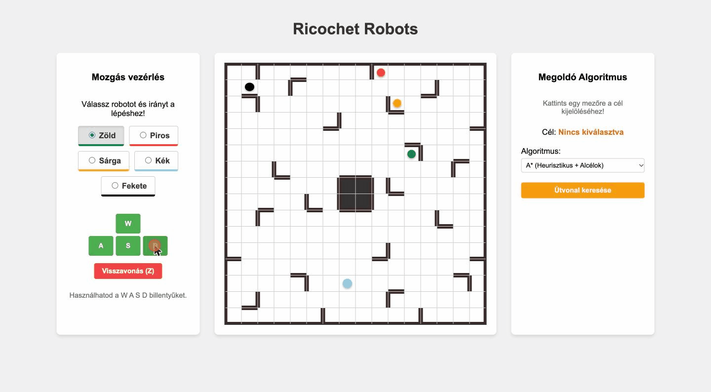

# Ricochet Robots megoldó

Szakdolgozat: a Ricochet Robots táblajáték webes megvalósítása és automatikus megoldása keresőalgoritmusokkal (BFS, A*, A* alcélokkal).



## A játék szabályai

A [Ricochet Robots](https://en.wikipedia.org/wiki/Ricochet_Robots) Alex Randolph társasjátéka (1999).

- A tábla 16×16 mezőből áll, a mezők között falak vannak. A tábla közepén egy 2×2-es elzárt terület található.
- A táblán több robot áll (itt 5).
- Egy lépésben egy robot elindul egy irányba (fel, le, balra, jobbra), és **addig csúszik, amíg falnak vagy másik robotnak nem ütközik**. Közben nem lehet megállni.
- A feladat: egy kiválasztott robotot a lehető **legkevesebb lépésből** eljuttatni egy célmezőre. A többi robot is mozgatható, például akadálynak, amin a célrobot megállhat.

## Futtatás

Python 3.9+ szükséges.

```bash
python3 -m venv .venv
source .venv/bin/activate
pip install -r requirements.txt
uvicorn src.main:app --reload
```

Ezután nyisd meg böngészőben: http://localhost:8000

## Használat

- **Mozgatás:** válassz robotot a bal oldalon, majd lépj a gombokkal vagy a `W` `A` `S` `D` billentyűkkel.
- **Visszavonás:** gomb vagy `Z`.
- **Robot áthelyezése:** a robot egérrel áthúzható bármelyik mezőre.
- **Megoldás:** kattints a célmezőre, válassz algoritmust, majd „Útvonal keresése”. A program nyilakkal rajzolja ki a megtalált lépéssort, és kiírja, hány állapotot vizsgált meg.

## Megvalósítás

Egy állapot az összes robot pozíciója. Egy állapotból legfeljebb robotok száma × 4 új állapot érhető el.

| Algoritmus | Mit csinál | Max. mélység |
|---|---|---|
| **BFS** (`solver.py`) | Szélességi keresés: rétegenként vizsgálja az állapotokat, ezért a legrövidebb megoldást találja meg, de sok állapotot kell bejárnia. | 10 lépés |
| **A\*** (`astar.py`) | A célból visszafelé kiszámolja minden mezőre, hány lépés kellene, ha a robot bárhol meg tudna állni. Ez alsó becslés a valódi lépésszámra, így a keresés a célhoz közelebbi állapotokat vizsgálja először. | 20 lépés |
| **A\* alcélokkal** (`astar_subgoal.py`) | Mint az A*, de azt is nyilvántartja, hol kellene egy segítő robotnak állnia, hogy a célrobot megálljon. Ha ott nincs robot, a becslés nő, így előnyben részesíti azokat az állapotokat, ahol a segítők már a helyükön vannak. | 20 lépés |

Egyenlő becslés esetén mindkét A* a célrobot lépéseit veszi előre.
